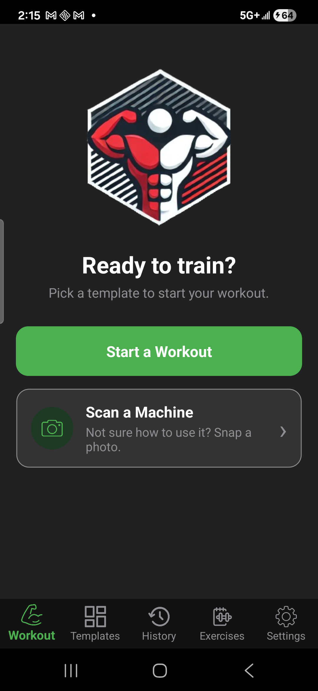
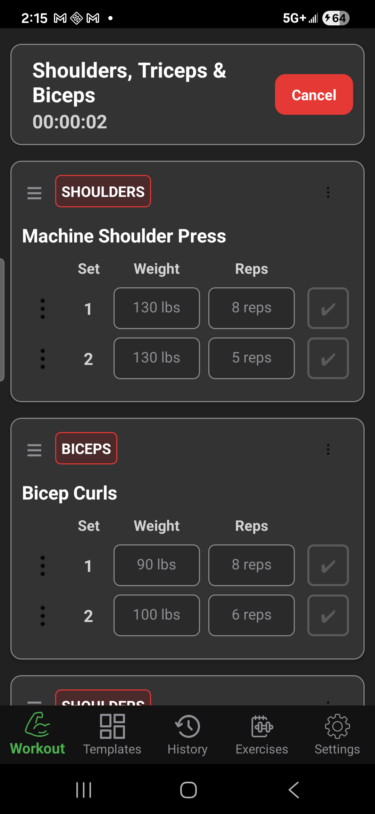
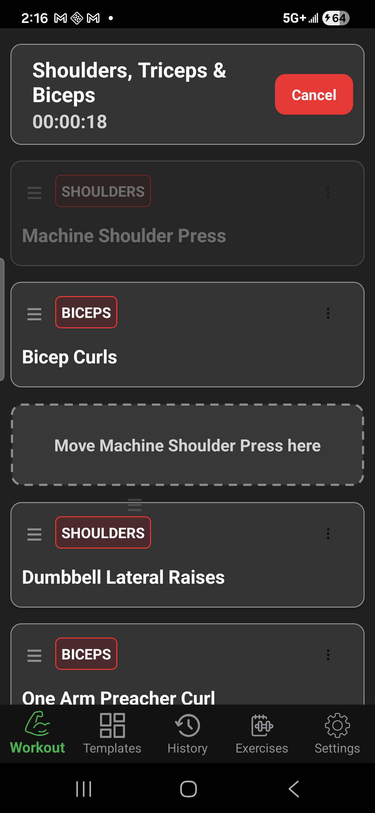
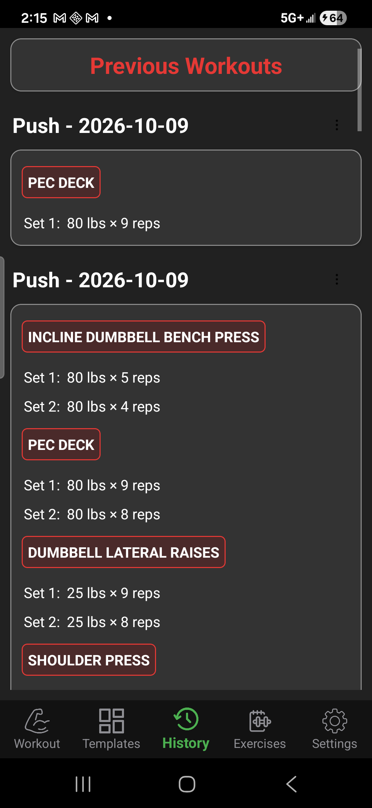
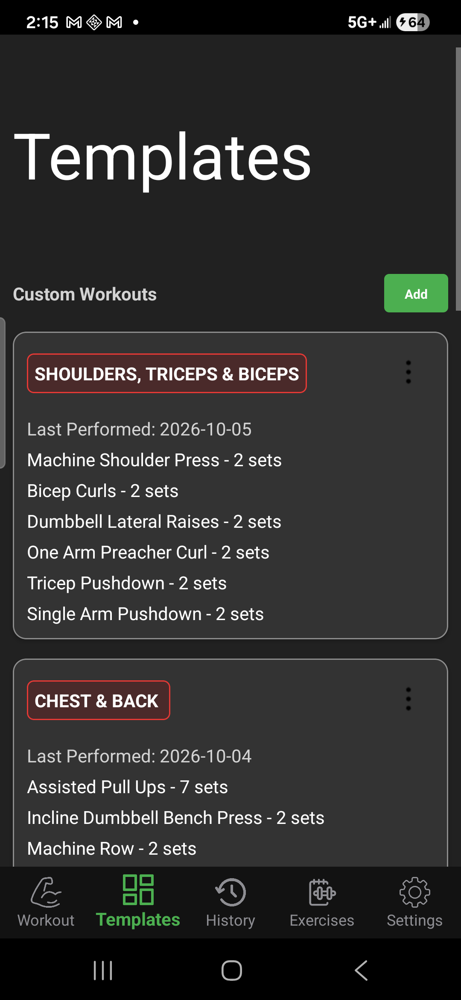
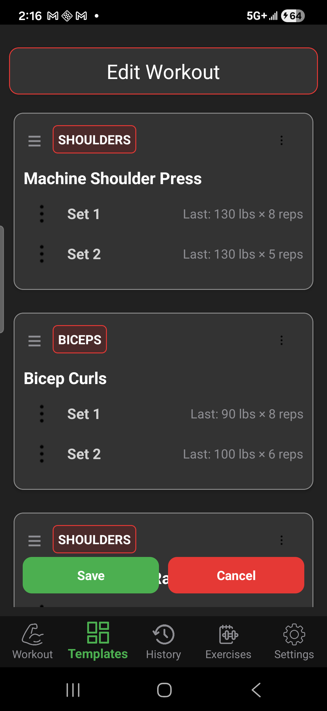
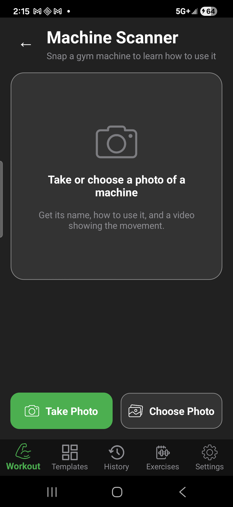
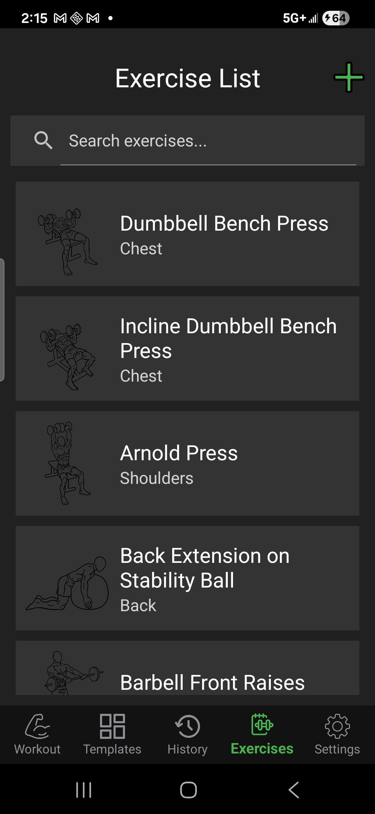
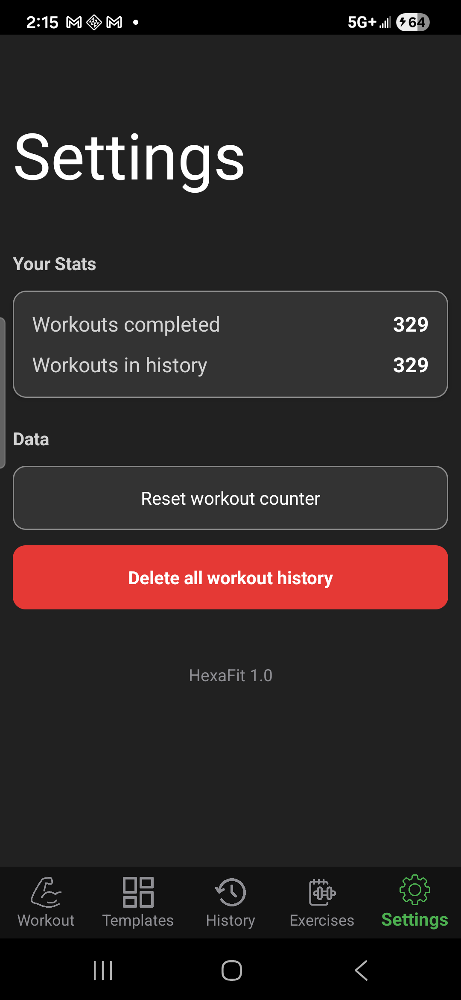

# HexaFit – Workout Tracking App

## Preview

  
  
  
  

   
   
   
   
   

---

## What is HexaFit?

Hexafit is a personal project of mine I built during summer at sheridan college, it's meant to be a realiable free workout app. While the play/app store is litered with thousands of gym apps,
they all have a caveat. Whether it being a limited amount of workout templates (looking at you myfitnesspal), massive amount of bloat, ads or a subscription model. Hexafit was designed to be bloat free, simple
UI design and completly free. I've personally been using this app for over 3 years after building it and never needed to switch.

---

## Features

**Workout Templates**
  - Choose from saved workouts
  - Create your own routines
  - Drag exercises to reorder them

**Track Your Sets**
  - Log reps, weight, and sets during workouts
  - Add, remove, rename and reorder exercises mid-workout
  - Changes you make during a workout are saved back to the template
  - Clean, distraction-free interface

**AI Machine Identification**
  - Take or upload a picture of a gym machine
  - Get a YouTube video showing how to use it
  
**Progress Tracking**
  - Automatically remembers your last workout reps & sets
  - Helps you progressively overload
  - Built in workout counter
  - Full workout history that loads as you scroll

**Local Storage**
  - Everything is saved on your device
  - No login or internet required
  
**Smart Cancel**
  - Prevents you from accidentally losing a workout

---

## Author

**Justin Kadyrov**  
Software Developer & Fitness Enthusiast
